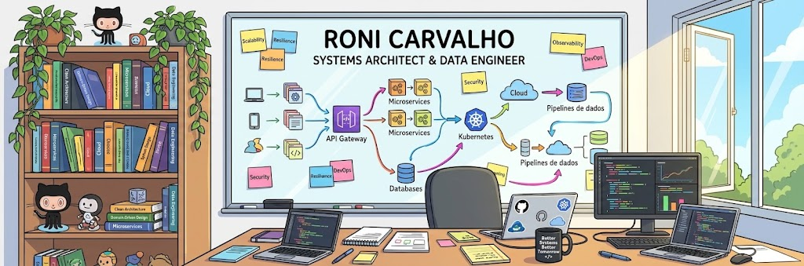

<!-- HEADER BANNER -->

  

 

<!-- LANGUAGE NAV -->

  <a href="#english"> <b>English</b></a> &nbsp;|&nbsp; 
  <a href="#português"> <b>Português</b></a>

 

<!-- TECH STACK ICONS -->

  

<h2 id="english"> English</h2>

### Hi, I'm Roni Carvalho

I am a Senior Software Engineer and Systems Architect with over 25 years of hands-on experience designing and modernizing high-scale enterprise software, transactional platforms, and data infrastructure. Throughout my career, I've built systems for heavily regulated industries including banking, private wealth management, pension funds, and large-scale retail.

My core technical foundation is built on Event-Driven Architecture (EDA), microservices, Site Reliability Engineering (SRE), and software testing methodologies (TDD/BDD). Recently, my work has been heavily centered on data engineering, real-time data streaming with Apache Kafka, automated ETL/ELT pipelines, and practical applications of Generative AI and RAG architectures.

### What I do & value

* **System Architecture & Scale:** Designing resilient, decoupled backend platforms using Hexagonal Architecture (Ports & Adapters), microservices, and event streaming.
* **Data & Engineering Quality:** Deep experience with relational (MSSQL, PostgreSQL, Oracle) and NoSQL databases (MongoDB, Redis), query optimization, and streaming integrations.
* **Engineering Standards:** Strong advocate for TDD, BDD, Clean Code, automated testing (unit, integration, load testing with JMeter), and CI/CD automation.
* **Continuous Growth:** Active learner with over 120+ courses and bootcamps completed recently, covering Cloud Native tools, Go, Java, AI Agents, and Security.

### Looking for

* Opportunities to architect and build complex, challenging, and high-impact systems in software and data engineering.
* Environments that value technical rigor, continuous learning, and architectural quality.

### Outside of Tech

* Long-term goal: After a long career behind the keyboard, my retirement plan is to step onto the mats as a Jiu-Jitsu instructor, teaching strategy, discipline, and resilience.

### Contact & Links

* **Email:** roni.carvalho@protonmail.com
* **LinkedIn:** [linkedin.com/in/ronicarvalho](https://www.linkedin.com/in/ronicarvalho)
* **Location:** Birigui, SP - Brazil

<h2 id="português"> Português</h2>

### Olá, sou o Roni Carvalho

Sou Engenheiro de Software Sênior e Arquiteto de Sistemas com mais de 25 anos de experiência prática no desenvolvimento e modernização de ecossistemas corporativos de alta escala, plataformas transacionais e infraestrutura de dados. Ao longo da minha trajetória, atuei em setores fortemente regulados como banking, private banking, previdência social e varejo/e-commerce.

Minha base técnica é fundamentada em Arquitetura Orientada a Eventos (EDA), microsserviços, Site Reliability Engineering (SRE) e práticas rigorosas de testes de software (TDD/BDD). Atualmente, meu foco de atuação e estudo está concentrado em engenharia de dados, streaming de dados em tempo real com Apache Kafka, pipelines de ETL/ELT e aplicação prática de IA Generativa e arquiteturas RAG.

### Minha atuação e diferenciais

* **Arquitetura e Escala:** Projeto de plataformas backend resilientes e desacopladas utilizando Arquitetura Hexagonal (Ports & Adapters), microsserviços e mensageria.
* **Dados e Performance:** Ampla bagagem em bancos de dados relacionais (MSSQL, PostgreSQL, Oracle) e NoSQL (MongoDB, Redis), incluindo otimização crítica de consultas e integração de dados.
* **Qualidade de Engenharia:** Aplicação constante de TDD, BDD, Clean Code, automação de testes (unitários, integração e carga com JMeter) e pipelines de CI/CD.
* **Aprendizado Contínuo:** Perfil autodidata com mais de 120 cursos e bootcamps concluídos recentemente, cobrindo ecossistemas Cloud Native, Go, Java, Agentes de IA e Segurança.

### O que busco

* Desafios focados na arquitetura e desenvolvimento de projetos complexos, inovadores e de grande impacto em engenharia de software e dados.
* Ambientes que valorizem rigor técnico, qualidade de código e evolução contínua.

### Fora do código

* Meta de longo prazo: Na aposentadoria, meu objetivo é transitar da tecnologia para os tatames como professor de Jiu-Jitsu, ensinando disciplina, estratégia e resiliência.

### Contato

* **E-mail:** roni.carvalho@protonmail.com
* **LinkedIn:** [linkedin.com/in/ronicarvalho](https://www.linkedin.com/in/ronicarvalho)
* **Localização:** Birigui, SP - Brasil